# DarGon

Пиксельное подземелье, которое проходят клетка за клеткой. Ловушки, арбалеты и огнемёты, камикадзе, тёмные коридоры, где видно только то, что освещает факел, двери с ключами, кнопки, телепорты и лавки. Каждый уровень — маленькая головоломка: как пройти и не погибнуть.

Игра для ПК (Windows, Linux) и Android. Свои уровни можно сделать в редакторе паков и поделиться ими одним файлом.

<p align="center">
  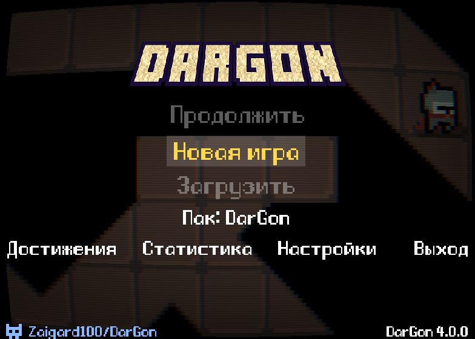
  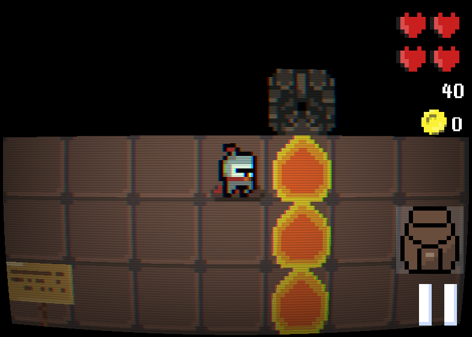
</p>
<p align="center">
  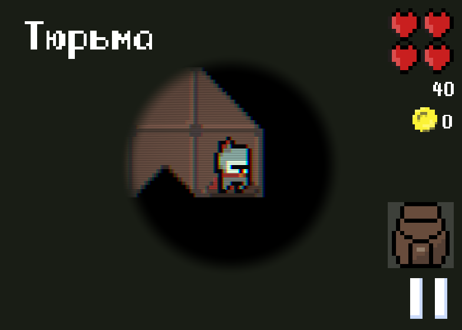
  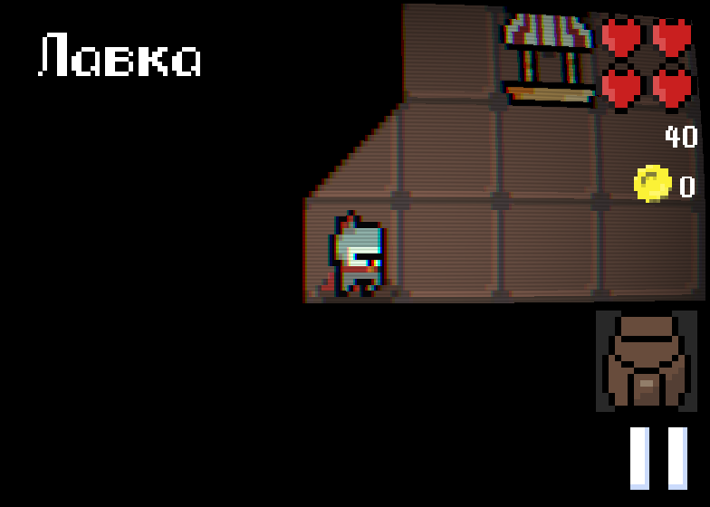
  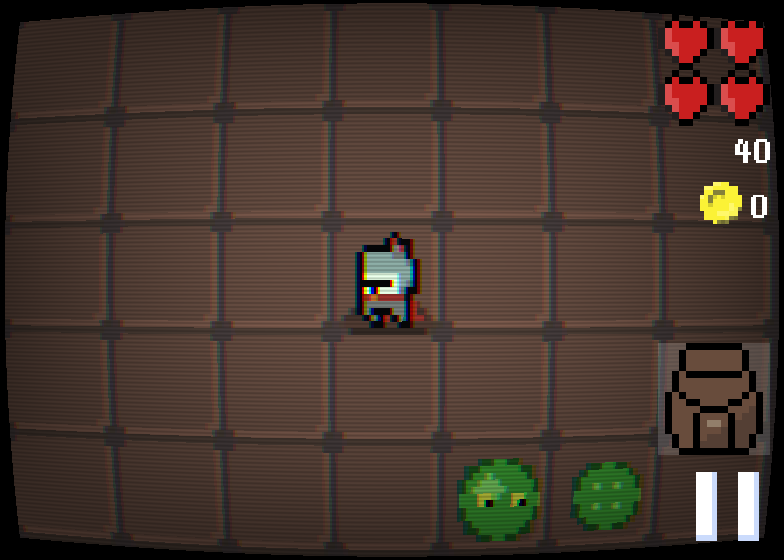
</p>

## Об игре

- **Кампания** — 27 уровней подземелья, лавки между актами, 26 достижений (есть и скрытые).
- **Опасности** — шипы, скрытые ловушки, хрупкий пол, арбалеты (в том числе наводящиеся), огнемёты, камикадзе, ядовитые зоны.
- **Предметы** — зелья лечения, скорости и замедления, щиты, факелы, зелье зоркости, показывающее скрытые ловушки, ключи; монеты тратятся в лавках.
- **Тёмные уровни** — без факела видно только соседние клетки.
- **Режимы** — казуал, обычный и хардкор: разные стартовые наборы и правила сохранений. В обычном режиме после двух смертей подряд уровень начинается заново, после третьей — откат к контрольной точке. На хардкоре любая смерть — откат.
- **Сохранения** — три слота, статистика прохождений (смерти по причинам, время, потраченные предметы).
- **Управление** — клавиатура (клавиши переназначаются), мышь (щелчок по клетке — дойти туда), геймпад, сенсорный экран с настраиваемой крестовиной.
- **Языки** — русский и английский.

<p align="center">
  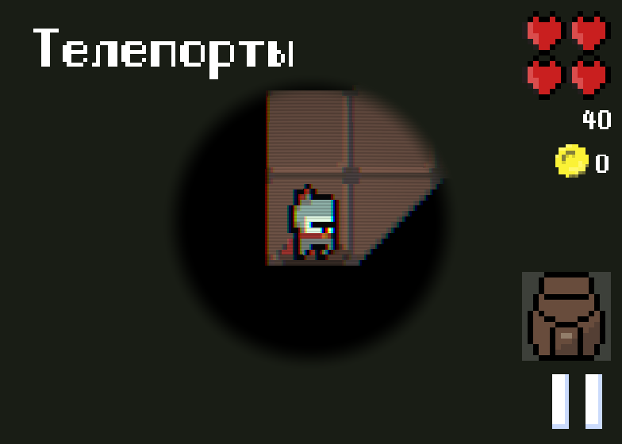
  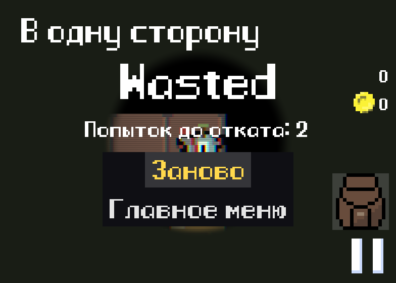
  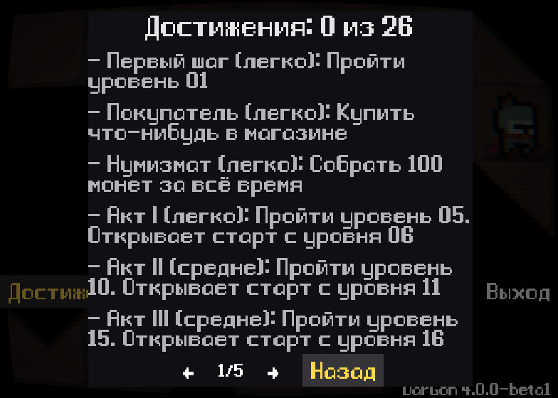
</p>

## Паки уровней

Кампания — встроенный пак. Кроме неё можно ставить паки других авторов: пак — это один файл `.dgpack` с уровнями, скриптами, своими объектами и картинками, текстами на двух языках, режимами и достижениями.

- На ПК файл кладут в папку `~/.dargon/packs`.
- На Android — «Паки» → «Добавить пак».
- Пак выбирается в главном меню: «Пак: …». Сохранения и достижения у каждого пака свои.

<p align="center">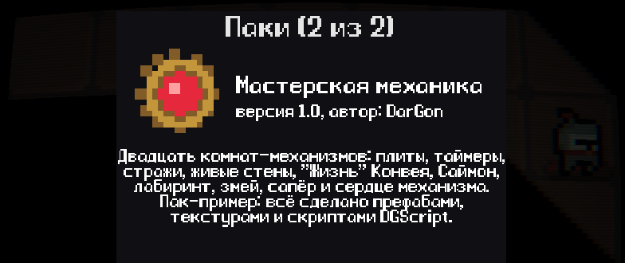</p>

В репозитории есть пак «Мастерская механика» (`examples/workshop`) — 20 комнат-механизмов: нажимные плиты, таймеры, стражи, огненный ритм, живые стены, мост, который строится под ногами, карусель телепортов, «Жизнь» Конвея, «Саймон», случайный лабиринт, змей, сапёр и финальная битва с сердцем механизма. Всё собрано только из того, что доступно любому автору паков. Что где — в [`examples/README.md`](examples/README.md).

<p align="center">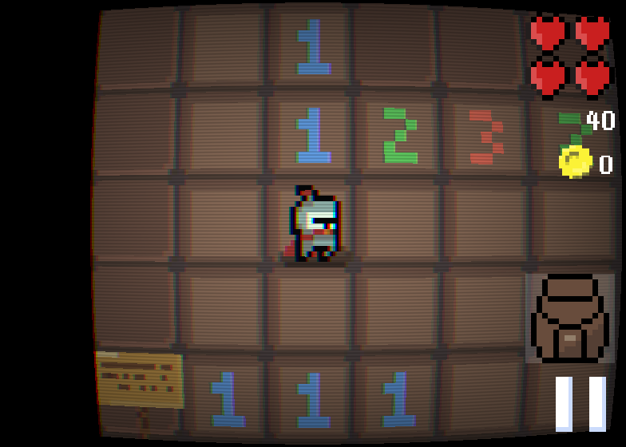</p>

## Редактор паков

Отдельная программа для ПК (Windows, Linux), в которой пак делается от первого уровня до готового файла.

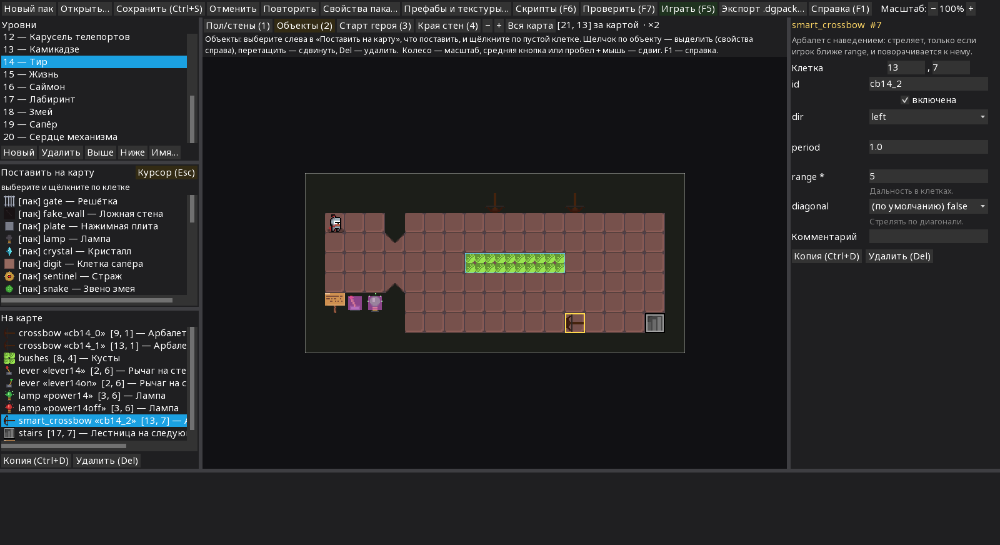

- **Карта** — рисование пола и стен, края стен подбираются сами (можно и вручную), масштаб, «вся карта».
- **Объекты** — список с картинками; под курсором видно, что поставится; области (зоны, кусты) — двумя щелчками по углам. Свойства выделенного объекта — справа, поле под каждый параметр.
- **Тексты** — сразу на русском и английском.
- **Свойства пака** — название, автор, иконка, режимы со стартовыми наборами, достижения с условиями и наградами.
- **Свои префабы и текстуры** — новые объекты собираются из готовых свойств игры (картинка, урон, преследование, сундук, телепорт…), картинки — обычные PNG.
- **Проверка** (F7) находит ошибки во всём паке; щелчок по ошибке ведёт к месту.
- **Пробный запуск** (F5) открывает игру прямо на текущем уровне.
- **Экспорт** — один файл `.dgpack`, готовый к установке.
- Отмена и повтор, перетаскиваемые панели, масштаб интерфейса, встроенная справка (F1).

### Скрипты

Логика уровней пишется на DGScript — небольшом языке, похожем на JavaScript. Кнопка или рычаг выполняют свой код, а у уровня есть свой скрипт: он может двигать объекты, менять карту, запускать таймеры, следить за шагами героя и выдавать достижения.

```
// Кнопка открывает решётку на 9 секунд.
def openGate() {
    entity("gate").disable()
    after(9, def() {
        entity("gate").enable()
    })
}
```

Общие функции выносятся в отдельный файл пака и подключаются в любом уровне строкой `use "utils"`.

В окне скриптов (F6) есть подсветка, проверка на лету и отладчик: уровень запускается в песочнице, скрипт останавливается на точках остановки, видны стек вызовов и переменные, консоль выполняет код прямо в мире уровня. Полный справочник с примерами — «Справка DGScript» в том же окне.

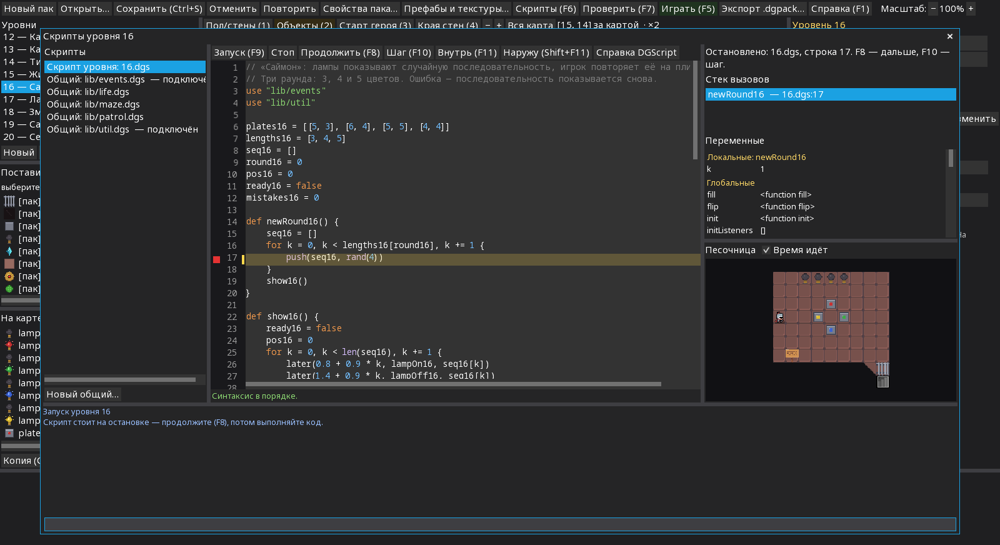

## Сборка из исходников

Нужен JDK 17 или новее; для Android — Android SDK с платформой 37 (`ANDROID_HOME` или `local.properties` с `sdk.dir=...`). Gradle ставить не нужно.

| Команда | Что делает |
|---|---|
| `./gradlew :desktop:run` | запустить игру |
| `./gradlew :tools:pack-editor:run` | запустить редактор паков |
| `./gradlew :android:installDebug` | поставить на подключённое Android-устройство |
| `./gradlew :desktop:packageLinuxX64 :desktop:packageWinX64` | сборки игры для Linux и Windows в `build/dist/` |
| `./gradlew :tools:pack-editor:packageLinuxX64 :tools:pack-editor:packageWinX64` | сборки редактора |
| `./gradlew check` | тесты, форматирование, проверка уровней и паков |

Код: `core/` — игра, `ecs/` — ядро сущностей, `dgscript/` — интерпретатор DGScript, `level/` — формат уровней и паков, `ui/` — интерфейс, `desktop/` и `android/` — запуск на платформах, `tools/` — редактор паков и проверка уровней, `assets/` — данные и картинки игры. Справочник по формату уровней и паков — JSON Schema в `assets/data/*.schema.json`.

Шрифт интерфейса редактора — Noto Sans (SIL OFL 1.1).

## Лицензия

MIT — см. [LICENSE](LICENSE).
